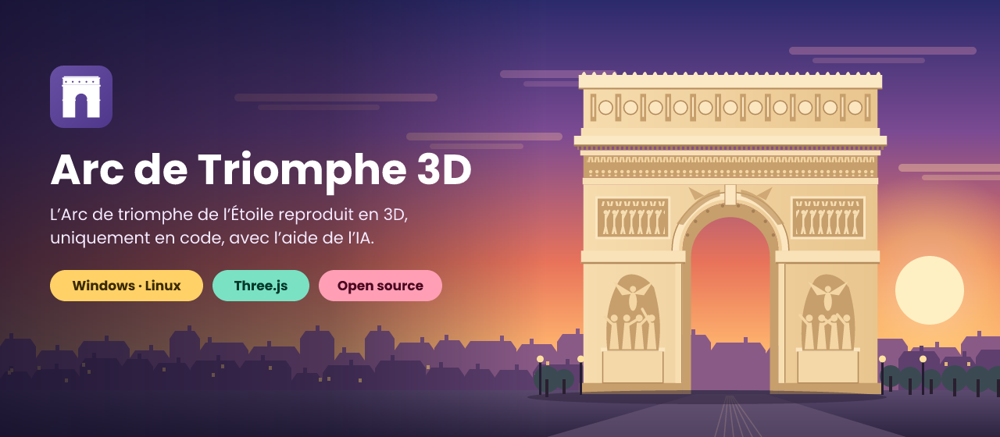
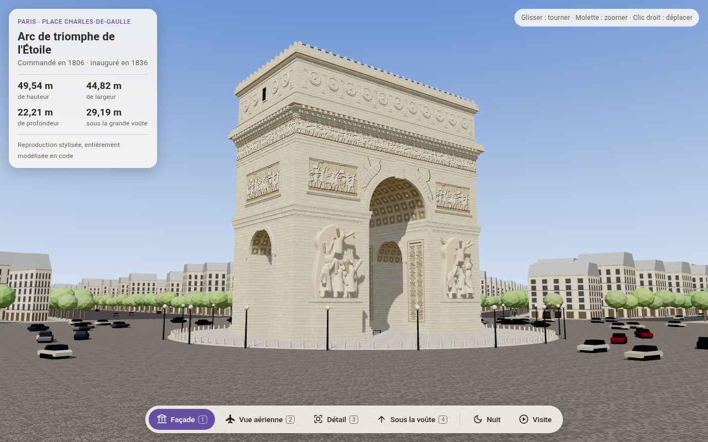
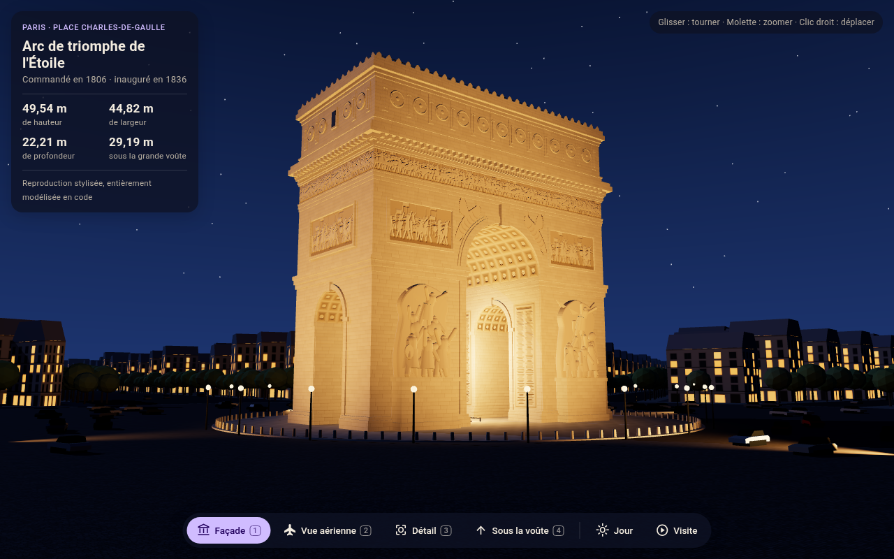
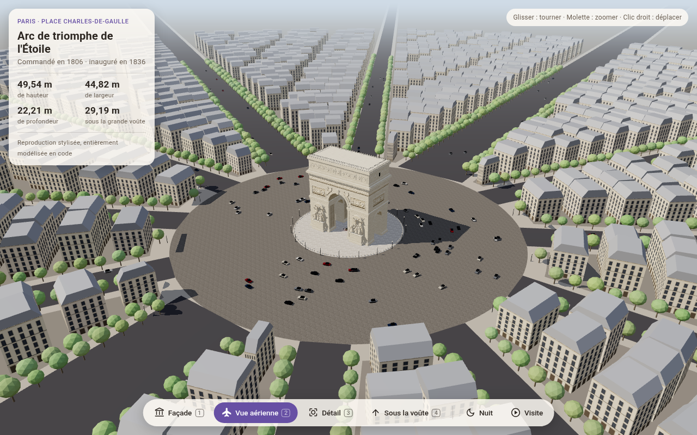
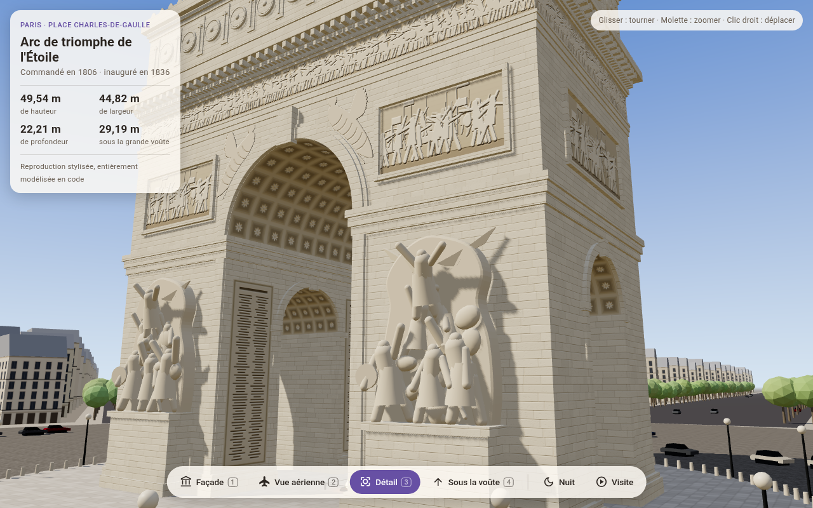
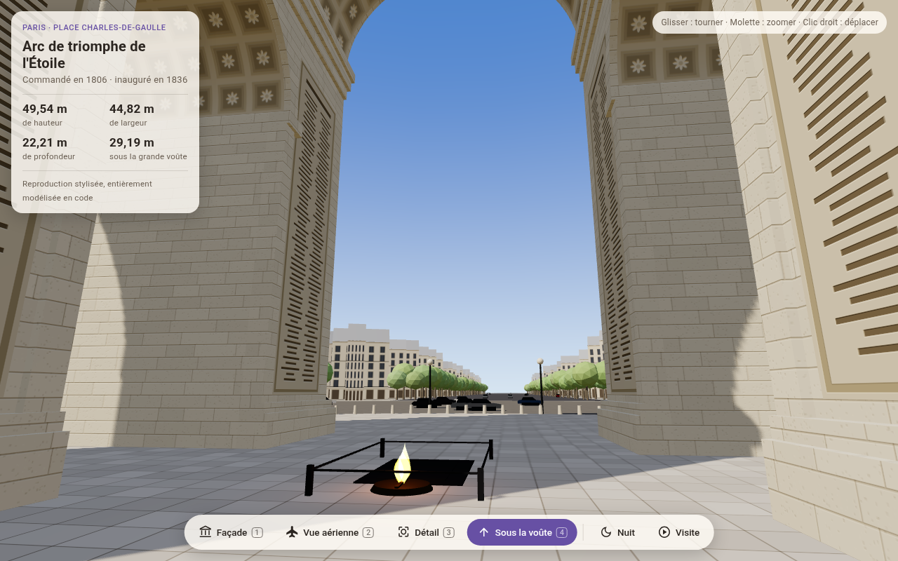

<p align="center">
  
</p>

<p align="center">
  <a href="https://github.com/JulesROGUE/arc-de-triomphe-3d/releases/latest"></a>
  
  
  <a href="LICENSE"></a>
</p>

<p align="center"><b>L'Arc de triomphe de l'Étoile reconstruit en 3D uniquement avec du code : on tourne autour, on zoome, on passe sous la voûte, de jour comme de nuit.</b></p>

<p align="center"><a href="https://github.com/JulesROGUE/arc-de-triomphe-3d/releases/latest"><b>⬇️ Télécharger (Windows / Linux)</b></a></p>

---

## L'idée

Le défi : reproduire un monument célèbre **sans aucun modèle 3D ni texture téléchargés**. Tout ce que vous voyez est généré par le code : géométries Three.js (extrusions, demi-cylindres, capsules, tores…) et textures dessinées dans des `<canvas>` (appareil de pierre, caissons à rosaces, bas-reliefs, frise, façades haussmanniennes).

Le projet a été réalisé **avec l'aide de l'IA** et calé sur des **images de référence réelles** : les cotes officielles (49,54 m de haut, 44,82 m de large, 22,21 m de profondeur, grande voûte de 29,19 m) fixent la silhouette, puis une élévation et une coupe de 1838 donnent la hauteur de chaque niveau (socle, piédestaux, bandeau d'imposte, bas-reliefs, entablement, attique). Les photos servent à compter les éléments répétés (30 boucliers de l'attique, modillons, palmettes) et à retrouver les couleurs et le contexte de la place de l'Étoile.

Le résultat est une reproduction **stylisée** : les sculptures sont évoquées par des volumes simples, pas copiées.

## Aperçu

<p>
  
  
</p>
<p>
  
  
</p>
<p>
  
</p>

## Références visuelles

Images consultées sur Wikimedia Commons pour mesurer et comparer. **Elles ne sont pas redistribuées** : ni dans l'application, ni dans ce dépôt.

| Image de référence | Ce qu'on en a tiré |
| --- | --- |
| [Élévation, *Allgemeine Bauzeitung* 1838 (Plan 180)](https://commons.wikimedia.org/wiki/File:Arc_de_Triomphe_ABZ_Wien_1838_Plan_180.jpg) | hauteur relative de chaque niveau, largeur des groupes et des bas-reliefs, 11 boucliers et 12 panneaux par grande face, clé de voûte, Renommées des écoinçons |
| [Coupe transversale, 1838 (Plan 182)](https://commons.wikimedia.org/wiki/File:Arc_de_Triomphe_Querschnitt_ABZ_Wien_1838_Plan_182.jpg) | voûte à caissons à rosaces, petites voûtes qui traversent les piles, saillie des groupes sculptés |
| [Plans, 1838 (Plan 181)](https://commons.wikimedia.org/wiki/File:Arc_de_Triomphe_Grundrisse_ABZ_Wien_1838_Plan_181.jpg) | piles pleines, petites voûtes centrées sur les petites faces |
| [Vue de trois quarts (2018)](https://commons.wikimedia.org/wiki/File:Arc_de_Triomphe,_Paris_16_February_2018_001.jpg) | point de vue « Façade », petite face (un bas-relief, 4 boucliers et une fenêtre à l'attique), bornes, couleur de la pierre |
| [Vue de nuit](https://commons.wikimedia.org/wiki/File:Arc_Triomphe.jpg) | ambiance de nuit : pierre dorée éclairée par en dessous, ciel bleu profond |
| [Vue depuis l'avenue (2012)](https://commons.wikimedia.org/wiki/File:Arc_de_Triomphe_de_l%C3%89toile,_Paris_7_June_2012.jpg) | proportions générales, platanes, pavés |
| [Vue aérienne de la place de l'Étoile](https://commons.wikimedia.org/wiki/File:Vue_a%C3%A9rienne_de_la_place_de_l%27%C3%A9toile.jpg) | terre-plein circulaire d'environ 70 m, anneau pavé, départ des avenues |
| [Place Charles-de-Gaulle vue du ciel](https://commons.wikimedia.org/wiki/File:Place_Charles_de_Gaulle_from_air.jpg) | point de vue « Vue aérienne », immeubles haussmanniens et toits en zinc |

## Ce qui est modélisé

| Élément | Construction | Dimensions retenues |
| --- | --- | --- |
| Piles et petites voûtes | profil avec cintre (`Shape`) extrudé sur la largeur de la pile | piles de 15,10 m, petites voûtes 18,68 × 8,44 m |
| Grande voûte | bloc extrudé évidé + demi-cylindre à caissons (CanvasTexture + bumpMap) | 29,19 × 14,62 m, naissance à 21,88 m |
| Socle, bandeau d'imposte, piédroits, archivoltes, clés | boîtes et demi-anneaux extrudés, fusionnés (`mergeGeometries`) | socle 1,7 m, bandeau de 19,9 à 21,88 m |
| 4 groupes sculptés | masse extrudée + personnages en capsules et sphères, génie aux ailes extrudées | piédestaux jusqu'à 6,6 m, groupes jusqu'à 18,6 m |
| 6 grands bas-reliefs et 4 Renommées | cadres en boîtes + scènes dessinées en CanvasTexture avec relief (bumpMap) | 11,1 × 6,2 m sur les piles, 13,6 × 6,2 m sur les petites faces |
| Entablement | architrave, frise en procession, denticules et modillons | de 32 à 39,4 m, larmier en saillie de 1,45 m |
| Attique | 30 boucliers (11 + 11 + 4 + 4), panneaux à glaive, fenêtres, palmettes, garde-corps | de 39,4 à 49,54 m |
| Tombe du Soldat inconnu | dalle, chaîne basse, flamme en `LatheGeometry` (rendu additif) | flamme côté Champs-Élysées |
| Place de l'Étoile | terre-plein dallé, anneau pavé, 12 avenues, bornes, réverbères | terre-plein de 36 m de rayon (stylisé) |
| Ville | immeubles haussmanniens, platanes et voitures en `InstancedMesh` | 2 376 immeubles, 1 326 arbres |

Performances : une trentaine de maillages au total (chaque matériau de l'arc est fusionné en un seul maillage, la ville est instanciée), et un rendu **à la demande** : l'image n'est recalculée que lorsque la caméra bouge.

## Commandes

| Action | Souris / clavier |
| --- | --- |
| Tourner autour | clic gauche + glisser |
| Zoomer | molette |
| Déplacer | clic droit + glisser |
| Points de vue | boutons **Façade**, **Vue aérienne**, **Détail**, **Sous la voûte** ou touches **1** à **4** |
| Jour / nuit | bouton **Nuit** / **Jour** |
| Visite | bouton **Visite** : rotation lente, qui s'arrête au premier geste |

## Installation

Téléchargez la dernière version sur la page [Releases](https://github.com/JulesROGUE/arc-de-triomphe-3d/releases/latest).

**Windows** : téléchargez le fichier `…-portable.exe` et lancez-le directement, sans installation.

> L'exécutable n'est pas signé : Windows SmartScreen peut afficher « Windows a protégé votre ordinateur ». Cliquez sur **Informations complémentaires** puis **Exécuter quand même**.

**Linux** :

```bash
# AppImage
chmod +x Arc*.AppImage
./Arc*.AppImage

# ou paquet Debian / Ubuntu
sudo apt install ./Arc*.deb
```

## Développement

```bash
git clone https://github.com/JulesROGUE/arc-de-triomphe-3d.git
cd arc-de-triomphe-3d
npm install
npm start       # build Vite puis lancement d'Electron
npm run dist    # paquets Windows / Linux dans release/
```

| Outil | Version | Rôle |
| --- | --- | --- |
| [Three.js](https://threejs.org/) | 0.187.0 | rendu WebGL, géométries, OrbitControls |
| Electron | 45 | application de bureau |
| Vite | 8 | build |
| React | 19 | surcouche (fiche, boutons) |
| electron-builder | 26 | exécutable portable Windows, AppImage et .deb |
| GitHub Actions | — | compilation des versions Windows et Linux |

Organisation du code :

```
src/
  scene/       renderer, caméra et contrôles, lumières, ciel, sol, ville
  model/       une partie de l'arc par fichier + dimensions.js (cotes et sources)
  ui/          surcouche HTML
  viewpoints.js  points de vue nommés (#facade, #aerien, #detail, #voute)
```

## Sources

- Wikipédia : [Arc de triomphe de l'Étoile](https://fr.wikipedia.org/wiki/Arc_de_triomphe_de_l%27%C3%89toile) (fr) et [Arc de Triomphe](https://en.wikipedia.org/wiki/Arc_de_Triomphe) (en) : dimensions, dates, sculpteurs, nombre de boucliers
- Site officiel du monument (Centre des monuments nationaux) : [paris-arc-de-triomphe.fr](https://www.paris-arc-de-triomphe.fr/)
- *Allgemeine Bauzeitung*, Vienne, 1838 : élévation, coupe et plans (voir Références visuelles)

## Licence

Code sous licence [MIT](LICENSE) © Jules ROGUE. Police Roboto sous licence SIL Open Font License, icônes Material Symbols sous licence Apache 2.0.

Il s'agit d'une **reproduction stylisée et non officielle**, réalisée à des fins de démonstration, sans lien avec le monument ni avec son gestionnaire, le Centre des monuments nationaux.
